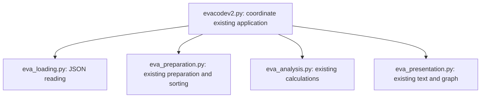

# Extraction plan and module contracts

This plan is recorded before changing the application. The aim is to extract the
inherited blocks, preserve their data representation/operations, then add the required
comparison separately. No replacement app, new domain model or framework is planned.

Arrows are Python imports, not network calls. No responsibility module imports another.
At runtime the coordinator passes values from loading to preparation, analysis and
presentation. The shared interface remains the inherited tuple `(datetime, hours, country)`.

| Module | Responsibility and interface | Inherited block |
|---|---|---|
| eva_loading | load_eva_data(filename) -> JSON values | json.load and file open |
| eva_preparation | prepare_records(eva_data) -> sorted tuple list | date/duration checks, conversion, append, sort |
| eva_analysis | cumulative_duration(records) -> dates, cumulative_hours; total_duration_for_country(records, selected_country) -> hours | running sum and case-insensitive country sum |
| eva_presentation | display_country_total(country, hours); plot_cumulative_duration(dates, cumulative_hours) | existing print and pyplot calls |
| evacodev2 | main() -> coordinate original execution | load, prepare, calculate, prompt, display |

Each group has one coherent reason to change. Reading concerns the JSON source;
preparation concerns the source-to-tuple rules; analysis concerns numeric questions;
presentation concerns text/chart choices; execution concerns their order and user input.
The original `evacodev2.py` remains the executable coordinator, with a main guard to
prevent import-time execution. It is not reduced to a compatibility shim.

Records must follow the inherited schema; cumulative_duration expects chronological
records as returned by prepare_records. Dates/durations/countries with malformed present
values retain inherited failure behaviour. The new comparison will validate its own
user input without silently changing the data preparation policy. Tuple interfaces are
simple but positional; a future representation migration must be justified separately.

## Added comparison interface

`compare_countries(records, country_a, country_b, start_year, end_year)` returns a dict
with first, second, start_year, end_year and winner keys. Each summary has country,
count, total_hours and average_hours. None means unavailable average or a tie winner,
respectively. Invalid year/country input raises ValueError. Prepared tuple records are
unchanged. The existing coordinator catches new comparison errors and delegates to
`display_comparison(result)` in presentation. The existing country total is reused;
no new import dependencies between responsibility modules are needed.
